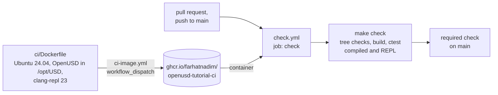

# CI builds and runs every lesson in a prebuilt OpenUSD image (issue #5)



## Problem

The runners of GitHub have no OpenUSD. `.github/workflows/check.yml` runs
`make check-tree` only. No check on GitHub builds a lesson or runs it. The
pull request checklist asks the author for a local `make check`, and nothing
confirms it.

Since 2026-11-10 the machine of the author cannot run `make check`
(issue #11). From that date, no check built or ran a lesson.

## Requirements

- **R1.** For each pull request and each push to `main`, continuous
  integration builds every lesson and runs it, as a compiled program and at
  the interactive prompt.
- **R2.** A lesson that fails makes the required check fail.
- **R3.** The tree checks still run, and a pull request must still close an
  issue.
- **R4.** A check run does not build OpenUSD. OpenUSD is built only when a
  person starts that build.
- **R5.** The repository records the OpenUSD version and the compiler
  version of the prompt that continuous integration uses. A change to them
  lands as a change to the repository.
- **R6.** A pull request from a fork gets the same check.
- **R7.** A check run completes in 15 minutes or less.

## Specification

- **S1 (R4, R5). The image.** `ci/Dockerfile` starts from `ubuntu:24.04`.
  It installs:
  - from Ubuntu: `build-essential` (GCC 13), `cmake`, `make`, `git`,
    `python3`, `curl`, `ca-certificates`, `gh`, and `libgl-dev`
    (`cmake/OpenUSDExample.cmake` calls `find_package(OpenGL REQUIRED)`);
  - from apt.llvm.org, suite `llvm-toolchain-noble-23`: `clang-23` and
    `clang-tools-23`, which gives `clang-repl-23`.
- **S2 (R4, R5). OpenUSD in the image.** The Dockerfile has the argument
  `OPENUSD_REF`. Its default is
  `6792941c5d5b42778e6875c5ed5a3279e6936981`, the commit of the install on
  the machine of the author (version 0.26.11). The Dockerfile gets that
  commit from `github.com/PixarAnimationStudios/OpenUSD` and runs:

  ```sh
  python3 build_scripts/build_usd.py --no-python --no-imaging --no-usdview \
      --no-materialx --no-examples --no-tutorials --no-tools --no-docs \
      --no-tests /opt/USD
  ```

  The same `RUN` step deletes `/opt/USD/src` and `/opt/USD/build`.
  `/opt/USD` is in the candidate list of `cmake/OpenUSDExample.cmake`,
  thus the build finds it with no setting. The lessons link `usd`,
  `usdGeom`, `usdLux` and `usdShade`, and lesson 06 adds `usdPhysics`
  (issue #3). This build includes them all. The `usd` profile of cpp-repl
  supports an install with no Python.
- **S3 (R4, R5). The image build.** `.github/workflows/ci-image.yml` runs
  on `workflow_dispatch` only. Its input `openusd_ref` goes to
  `OPENUSD_REF`. Its permissions are `contents: read` and
  `packages: write`. It logs in to `ghcr.io` with `GITHUB_TOKEN`, builds
  `ci/Dockerfile` and pushes
  `ghcr.io/farhatnadim/openusd-tutorial-ci:usd-<short ref>-clang23`. A tag
  is written one time: a different image gets a different tag.
- **S4 (R6).** The owner sets the visibility of the package to public, one
  time, in the package settings on GitHub. Then a job needs no credentials
  to pull the image.
- **S5 (R1, R2, R3). The check.** In `.github/workflows/check.yml`, the
  job keeps the name `check`, because the ruleset on `main` requires a
  check of that name. The job gets
  `container: ghcr.io/farhatnadim/openusd-tutorial-ci:<tag of S3>`. The
  step "The pull request closes an issue" stays. The step `make check-tree`
  becomes `make check`, which runs the tree checks first.
- **S6 (R5).** The tag in `check.yml` is the record. A new OpenUSD commit
  or a new clang-repl version needs a new image and a change of that tag
  by pull request.
- **S7 (R7).** The first pull request that uses the image records the
  duration of the job in its description. If the job takes more than 15
  minutes, the cause is found before the merge.
- **S8.** The sentences that say that CI has no OpenUSD change in the same
  pull request as S5: the header comment of `check.yml`,
  `.github/pull_request_template.md`, `CONTRIBUTING.md` (step 3) and the
  root `README.md` ("Build"). `AGENTS.md` has the same sentences in
  "Build" and in "How changes land". Only a human enters text in
  `AGENTS.md`, thus the human changes them.

## Order of work

A workflow can start by `workflow_dispatch` only when its file is on
`main`. Thus the work lands in two pull requests:

1. `ci/Dockerfile` and `ci-image.yml` (S1 to S3). A pull request must
   close an issue, thus this part gets its own issue.
2. The owner starts the workflow and makes the package public (S4).
3. `check.yml` and the documents (S5 to S8). This pull request closes
   issue #5.

## Verification

| Requirement | Check |
| --- | --- |
| R1 | The log of the job `check` shows each lesson test and each `repl_` test |
| R2 | A test pull request with a lesson that returns 1 gets a failed `check` |
| R3 | The log shows `check-tree`; a pull request that closes no issue fails |
| R4 | The job log has no OpenUSD compile step |
| R5 | `check.yml` names the image tag; the tag names the OpenUSD commit and clang 23 |
| R6 | An anonymous `docker pull` of the image passes |
| R7 | The job duration on the first pull request |

## Facts checked

Checked on 2026-11-23:

- apt.llvm.org has the suite `llvm-toolchain-noble-23`.
- `build_usd.py` at commit `6792941c5` has all the flags of S2.
- The repository is public.
- The `usd` profile of cpp-repl reads `PXR_PYTHON_SUPPORT_ENABLED` from
  the install and adds no Python header when it is off.

## Open decisions

- **D1.** S2 pins the commit of the local install, so that the transcripts
  of `repl/TUTORIAL.md` agree with CI. The alternative is the release tag
  `v26.08`.
- **D2.** S2 builds OpenUSD with no Python. The lessons are C++ and need
  none. The local install has Python (issue #11), thus the two builds are
  not the same.
- **D3.** S4 makes the image public. The alternative is a private image
  and `packages: read` in the job, which a fork cannot use.
