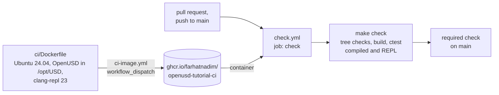

# CI builds and runs every lesson in a prebuilt OpenUSD image (issue #5)



## Problem

The runners of GitHub have no OpenUSD. `.github/workflows/check.yml` runs
`make check-tree` only. No check on GitHub builds a lesson or runs it. The
pull request checklist asks the author for a local `make check`, and nothing
confirms it.

Since 2026-11-10 the machine of the author cannot run `make check`
(issue #11). From that date, no check built or ran a lesson.

## Requirements

- **R1.** For each pull request and each push to `main`, continuous
  integration builds every lesson and runs it, as a compiled program and at
  the interactive prompt.
- **R2.** A lesson that fails makes the required check fail.
- **R3.** The tree checks still run, and a pull request must still close an
  issue.
- **R4.** A check run does not build OpenUSD. OpenUSD is built only when a
  person starts that build.
- **R5.** The repository records the OpenUSD version and the compiler
  version of the prompt that continuous integration uses. A change to them
  lands as a change to the repository.
- **R6.** A pull request from a fork gets the same check.
- **R7.** A check run completes in 15 minutes or less.

## Specification

- **S1 (R4, R5). The image.** `ci/Dockerfile` starts from `ubuntu:24.04`.
  It installs:
  - from Ubuntu: `build-essential` (GCC 13), `cmake`, `make`, `git`,
    `python3`, `curl`, `ca-certificates`, `libgl-dev`
    (`cmake/OpenUSDExample.cmake` calls `find_package(OpenGL REQUIRED)`) and
    `python3-dev`. cpp-repl needs `python3-dev` only: its usd profile asks
    for `Python.h` when OpenUSD has no Python support
    (farhatnadim/cpp_repl#35). No OpenUSD header includes `Python.h` in this
    image, because the define is off;
  - from cli.github.com, suite `stable`: `gh`. The `gh` 2.45 of Ubuntu 24.04
    has no field `closingIssuesReferences`, which the step "The pull request
    closes an issue" reads;
  - from apt.llvm.org, suite `llvm-toolchain-noble-23`: `clang-23` and
    `clang-tools-23`, which gives `clang-repl-23`. `/usr/lib/llvm-23/bin` is
    first in `PATH`, because `repl/TUTORIAL.md` calls `clang++` with no
    version suffix. CMake still finds `c++` (GCC 13) for the lessons.
- **S2 (R4, R5). OpenUSD in the image.** The Dockerfile has the argument
  `OPENUSD_REF`. Its default is
  `6792941c5d5b42778e6875c5ed5a3279e6936981`, the commit of the install on
  the machine of the author (version 0.26.11). The Dockerfile gets that
  commit from `github.com/PixarAnimationStudios/OpenUSD` and runs:

  ```sh
  python3 build_scripts/build_usd.py --no-python --no-imaging --no-usdview \
      --no-materialx --no-examples --no-tutorials --no-tools --no-docs \
      --no-tests /opt/USD
  ```

  The same `RUN` step writes the asked ref and the commit in
  `/opt/USD/openusd-ref`, and deletes `/opt/USD/src`, `/opt/USD/build` and
  the checkout. The argument `JOBS` sets the parallel compile jobs; its
  default is the number of CPUs.
  `/opt/USD` is in the candidate list of `cmake/OpenUSDExample.cmake`,
  thus the build finds it with no setting. The lessons link `usd`,
  `usdGeom`, `usdLux` and `usdShade`, and lesson 06 adds `usdPhysics`
  (issue #3). This build includes them all. The `usd` profile of cpp-repl
  supports an install with no Python.
- **S3 (R4, R5). The image build.** `.github/workflows/ci-image.yml` runs
  on `workflow_dispatch` only. Its input `openusd_ref` goes to
  `OPENUSD_REF`. Its permissions are `contents: read` and
  `packages: write`. It logs in to `ghcr.io` with `GITHUB_TOKEN`, builds
  `ci/Dockerfile` and pushes
  `ghcr.io/farhatnadim/openusd-tutorial-ci:usd-<short ref>-clang23`. The
  short ref is the first 9 characters of a commit, or the tag as it is. A tag
  is written one time: the run stops when the tag exists. A different image
  gets a different tag. The last step runs `clang-repl-23 --version` in the
  pushed image and reads `/opt/USD/openusd-ref`.
- **S4 (R6).** The owner sets the visibility of the package to public, one
  time, in the package settings on GitHub. Then a pull request from a fork
  can pull the image. The job also logs in to `ghcr.io` with
  `GITHUB_TOKEN` (`packages: read`), thus the check of the owner works
  before the package is public.
- **S5 (R1, R2, R3). The check.** In `.github/workflows/check.yml`, the
  job keeps the name `check`, because the ruleset on `main` requires a
  check of that name. The job gets
  `container: ghcr.io/farhatnadim/openusd-tutorial-ci:<tag of S3>`, with
  the `credentials` of S4, and `timeout-minutes: 30`. The step "The pull
  request closes an issue" stays. The step `make check-tree` becomes
  `make check`, which runs the tree checks first.
- **S6 (R5).** The tag in `check.yml` is the record. A new OpenUSD commit
  or a new clang-repl version needs a new image and a change of that tag
  by pull request.
- **S7 (R7).** The first pull request that uses the image records the
  duration of the job in its description. If the job takes more than 15
  minutes, the cause is found before the merge.
- **S8.** The sentences that say that CI has no OpenUSD change in the same
  pull request as S5: the header comment of `check.yml`,
  `.github/pull_request_template.md`, `CONTRIBUTING.md` (step 3) and the
  root `README.md` ("Build"). `AGENTS.md` has the same sentences in
  "Build" and in "How changes land". Only a human enters text in
  `AGENTS.md`, thus the human changes them.

## Order of work

A workflow can start by `workflow_dispatch` only when its file is on
`main`. Thus the work lands in two pull requests:

1. `ci/Dockerfile` and `ci-image.yml` (S1 to S3). A pull request must
   close an issue, thus this part gets its own issue.
2. The owner starts the workflow and makes the package public (S4).
3. `check.yml` and the documents (S5 to S8). This pull request closes
   issue #5.

## Verification

| Requirement | Check |
| --- | --- |
| R1 | The log of the job `check` shows each lesson test and each `repl_` test |
| R2 | A test pull request with a lesson that returns 1 gets a failed `check` |
| R3 | The log shows `check-tree`; a pull request that closes no issue fails |
| R4 | The job log has no OpenUSD compile step |
| R5 | `check.yml` names the image tag; the tag names the OpenUSD commit and clang 23 |
| R6 | An anonymous `docker pull` of the image passes |
| R7 | The job duration on the first pull request |

## Facts checked

Checked on 2026-11-23:

- apt.llvm.org has the suite `llvm-toolchain-noble-23`.
- `build_usd.py` at commit `6792941c5` has all the flags of S2.
- The repository is public.
- The `usd` profile of cpp-repl skips the libraries that an install does
  not have (`libusd_python.so`).

Checked on 2026-11-23 with the image built on the machine of the author:

- The image builds in 10 min 22 s with 12 jobs, and is 1.22 GB.
- The usd profile of cpp-repl reads the text
  `#define PXR_PYTHON_SUPPORT_ENABLED` and not the `#if 0` before it. With
  no `Python.h`, every `repl_` test stopped (farhatnadim/cpp_repl#35), thus
  S1 adds `python3-dev`.
- `repl/TUTORIAL.md` calls `clang++`, thus S1 puts `/usr/lib/llvm-23/bin`
  first in `PATH`.
- In the image, with 4 CPUs, `make check` on a clone of `main` passes 45 of
  45 tests in 53 s.

## State on 2026-11-23

- S1 to S3 landed with issue #17 (pull request #24).
- The owner started `ci-image` on `main` (run 45199226679). It built and
  pushed `ghcr.io/farhatnadim/openusd-tutorial-ci:usd-6792941c5-clang23` in
  20 min. In the image: clang-repl 23.1.6, OpenUSD at
  `6792941c5d5b42778e6875c5ed5a3279e6936981`, `gh` 2.105.0.
- R6: the package is public from its first push. A request with no
  credentials gets the manifest (HTTP 200), thus S4 needs no action.
- R2: in the image, a clone of `main` in which lesson 13 returns 1 gives
  `13_default_prim (Failed)` and `repl_13_default_prim (Failed)`, and
  `make check` exits with 2.
- S5 to S8 are in the pull request of issue #5. Its description records
  the duration of the job (S7).
- `AGENTS.md` still says that CI has no OpenUSD, in "Build" and in "How
  changes land". Only a human enters text in `AGENTS.md` (S8).

## Decisions

The human gave the instruction to finish the work on 2026-11-23. The agent
took the proposals of this plan:

- **D1.** S2 pins the commit of the local install,
  `6792941c5d5b42778e6875c5ed5a3279e6936981`, so that the transcripts of
  `repl/TUTORIAL.md` agree with CI.
- **D2.** S2 builds OpenUSD with no Python. The image has `python3-dev` for
  cpp-repl only (S1, farhatnadim/cpp_repl#35).
- **D3.** The image is public (S4). The owner sets it in the package
  settings; the job logs in, thus it does not wait for that setting.
