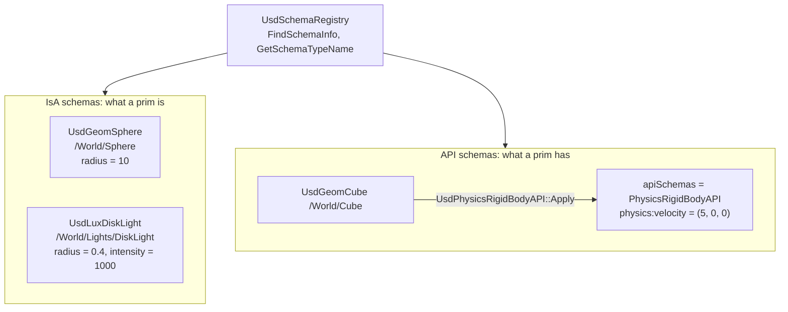

# Lesson 06_schemas is ported (issue #3)

## Problem

`nvidia_tutorials/06_schemas` holds a placeholder `README.md`. The lesson
has no C++ port, no build and no test. The lesson index says "not yet
ported".

The NVIDIA page
([Schemas](https://docs.nvidia.com/learn-openusd/latest/scene-description-blueprints/schemas.html))
has four Python snippets under "Working With Python". The snippets have no
"Example N" title. The page shows no output for them.

| Snippet | What it does |
| --- | --- |
| Schema registry | Names `Usd.SchemaRegistry.FindSchemaInfo()` and `GetSchemaTypeName()`, with no arguments |
| `UsdGeomSphere` | Defines `/World/Sphere`, sets the radius to 10 |
| `UsdLuxDiskLight` | Defines `/World/Lights/DiskLight`, gets the schema attribute names, sets the radius to 0.4 and the intensity to 1000 |
| `UsdPhysicsRigidBodyAPI` | Defines `/World/Cube` on an in-memory stage, applies the API, gets the kinematic-enabled attribute, creates the velocity attribute with (5, 0, 0) |

## Requirements

- **R1.** Lesson 06 has a C++ port of each code snippet of the NVIDIA
  Schemas page.
- **R2.** Each example prints its result, because the page shows no output.
- **R3.** The lesson runs as a compiled program and at the interactive
  prompt, and the full check includes it.
- **R4.** The lesson index names the lesson and its concepts. The
  placeholder goes.

## Specification

- **S1 (R3).** Layout, as the other lessons:
  - `nvidia_tutorials/06_schemas/CMakeLists.txt` is a copy of the file of
    `05_prim_property_paths`. The project is `openusd_tutorial_schemas`.
    The last line is
    `add_usd_example(06_schemas main.cpp LIBS usd usdGeom usdLux usdPhysics)`.
  - `nvidia_tutorials/06_schemas/main.cpp` holds the lesson.
  - `nvidia_tutorials/06_schemas/README.md` (the placeholder) is deleted.
  - `nvidia_tutorials/CMakeLists.txt` gets `add_subdirectory(06_schemas)`
    between `05_prim_property_paths` and `07_scopes`. Its header comment
    stops naming `06_schemas` as a lesson without a build.
- **S2 (R1, R2).** `main.cpp` has the `PrintStage` function of the other
  lessons and one function for each snippet. `main()` calls the four
  functions in the order of the page. Each function that authors prims
  makes its stage with `UsdStage::CreateNew`, saves it and prints the root
  layer.
- **S3 (R1, R2). Example 1, the schema registry.** The page gives no
  arguments. The port asks the registry about one IsA schema and one API
  schema:
  - `UsdSchemaRegistry::FindSchemaInfo<UsdGeomSphere>()` gives a pointer to
    a `UsdSchemaRegistry::SchemaInfo`. The example prints its `identifier`,
    its `family` and its `kind`.
  - `UsdSchemaRegistry::GetSchemaTypeName<UsdGeomSphere>()` and
    `UsdSchemaRegistry::GetSchemaTypeName<UsdPhysicsRigidBodyAPI>()` each
    give a `TfToken`. The example prints the two tokens.
  - Expected: identifier `Sphere`, family `Sphere`, kind
    `UsdSchemaKind::ConcreteTyped`; type names `Sphere` and
    `PhysicsRigidBodyAPI`. The kind of `UsdPhysicsRigidBodyAPI` is
    `UsdSchemaKind::SingleApplyAPI`.
- **S4 (R1, R2). Example 2, `UsdGeomSphere`.** File
  `_assets/schemas_sphere.usda`.
  - `UsdGeomSphere::Define(stage, SdfPath("/World/Sphere"))`.
  - `GetRadiusAttr().Set(10.0)`. The Python gives the integer 10. In C++
    the value must be a `double`: `Set(10)` returns `false` with the error
    `Type mismatch for </World/Sphere.radius>: expected 'double', got 'int'`.
  - Expected in the layer: `def Sphere "Sphere"` with `double radius = 10`.
- **S5 (R1, R2). Example 3, `UsdLuxDiskLight`.** File
  `_assets/schemas_disk_light.usda`.
  - `UsdLuxDiskLight::Define(stage, SdfPath("/World/Lights/DiskLight"))`.
  - `UsdLuxDiskLight::GetSchemaAttributeNames()` is a static member
    function. Its argument `includeInherited` has the default `true`. The
    example prints the names.
  - `GetRadiusAttr().Set(0.4f)` and `GetIntensityAttr().Set(1000.0f)`. The
    two attributes are `float`.
  - Expected names: `visibility`, `purpose`, `xformOpOrder`, `extent`,
    `inputs:radius`. Expected in the layer: `def DiskLight "DiskLight"` with
    `float inputs:intensity = 1000` and `float inputs:radius = 0.4`.
- **S6 (R1, R2). Example 4, `UsdPhysicsRigidBodyAPI`.** File
  `_assets/schemas_rigid_body.usda`. The page uses an in-memory stage; the
  port writes a file, as the other lessons do.
  - `UsdGeomCube::Define(stage, SdfPath("/World/Cube"))`.
  - `UsdPhysicsRigidBodyAPI::Apply(cube.GetPrim())`.
  - `GetKinematicEnabledAttr()` and `Get(&value)` on it. The example prints
    the value.
  - `CreateVelocityAttr(VtValue(GfVec3f(5, 0, 0)))`.
  - Expected: the kinematic-enabled value is `false`. In the layer:
    `def Cube "Cube"` with `prepend apiSchemas = ["PhysicsRigidBodyAPI"]`
    and `vector3f physics:velocity = (5, 0, 0)`.
- **S7 (R1).** The headers that the lesson adds to those of the other
  lessons: `pxr/usd/usd/schemaRegistry.h`, `pxr/usd/usdGeom/sphere.h`,
  `pxr/usd/usdGeom/cube.h`, `pxr/usd/usdLux/diskLight.h`,
  `pxr/usd/usdPhysics/rigidBodyAPI.h`, `pxr/base/gf/vec3f.h`.
- **S8 (R4).** The row of the lesson in `nvidia_tutorials/README.md`
  becomes: `UsdSchemaRegistry::FindSchemaInfo`; the IsA schemas
  `UsdGeomSphere` and `UsdLuxDiskLight`; the API schema
  `UsdPhysicsRigidBodyAPI::Apply`.

## Who writes what

The human writes `main.cpp`, at the prompt first and then in the file. On
the instruction of the human, the agent makes the files of S1 and the row
of S8, builds, runs and shows the output.

## Verification

| Requirement | Check |
| --- | --- |
| R1, R2 | `cmake --build build --target 06_schemas`, then the program prints the expected values of S3 to S6 |
| R3 | `ctest --test-dir build -R 06_schemas` passes two tests: `06_schemas` and `repl_06_schemas` |
| R4 | `make check-tree` passes: the lesson is listed, built and indexed |

The compiled checks need issue #11.

## Facts checked at the prompt

All the expected values of S3 to S6 come from a run at the prompt on
2026-11-23 (OpenUSD 0.26.11). The prompt loads `usdLux` and `usdPhysics`
with no change to its profile. More facts from the same run:

- `UsdLuxDiskLight::GetSchemaAttributeNames(false)` gives only
  `inputs:radius`.
- `inputs:intensity` is not in the list of `GetSchemaAttributeNames(true)`.
  `GetIntensityAttr()` is available on `UsdLuxDiskLight`, and the page says
  that the attribute comes from `LightAPI`.
- `cube.GetPrim().HasAPI<UsdPhysicsRigidBodyAPI>()` gives `true` after
  `Apply`.

## Open decisions

- **D1.** S2 uses one `main.cpp` with four functions, as lesson 15 does.
  The alternative is one subdirectory for each example, as lessons 02, 03
  and 10 do.
- **D2.** S4 to S6 write one file for each example. The alternative is one
  stage for the three examples, which gives one layer with the sphere, the
  light and the cube.
