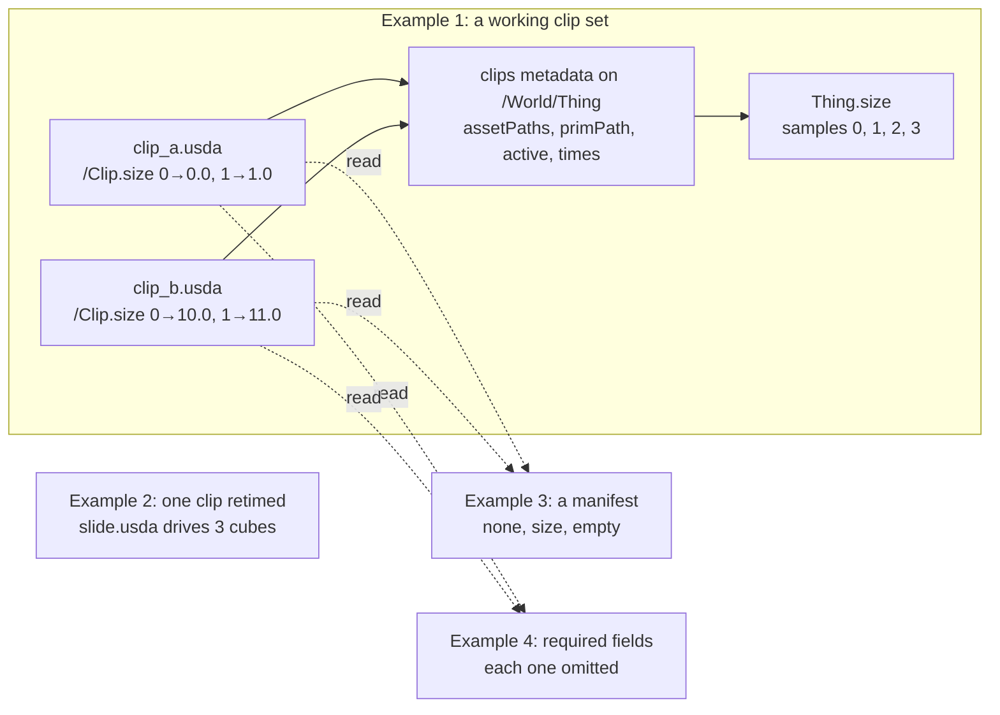

# Lesson 15_value_clips is ported (issue #10)

## Problem

Issue #10 has no text. The scaffold of the lesson is in the working tree of
the branch `10-lesson-15_value_clips-is-ported`, not committed:
`CMakeLists.txt`, a `main.cpp` with four empty functions, the
`add_subdirectory` line and an index row marked "in progress".

The NVIDIA page
([Value Clips](https://docs.nvidia.com/learn-openusd/latest/beyond-basics/value-clips.html))
has four Python examples and two helper functions. The page shows the
output of each example.

## Requirements

- **R1.** Lesson 15 has a C++ port of the four examples of the NVIDIA Value
  Clips page: a working clip set, one clip retimed, attribute selection
  with a manifest, and the required fields.
- **R2.** Each example prints the values that show its point.
- **R3.** The examples write their files in the asset directory of the
  lesson. A second run in the same directory gives the same output as the
  first run.
- **R4.** The lesson runs as a compiled program and at the interactive
  prompt, and the full check includes it.
- **R5.** The lesson index does not mark the lesson "in progress".

## Specification

All files are in `_assets/clips/` below the working directory.
`UsdClipsAPI` writes the `clips` metadata in the clip set `default`.

- **S1 (R3). Helpers.**
  - `FreshLayer(name)` gives an empty layer for `_assets/clips/<name>`. It
    calls `SdfLayer::FindOrOpen`. If that gives no layer, it calls
    `SdfLayer::CreateNew`. Then it calls `Clear()` on the layer.
    `SdfLayer::CreateNew` makes the directory and the file immediately
    (checked at the prompt). `FindOrOpen` gives the same layer object when
    the layer is open.
  - `Sample(attr, times)` reads the attribute at each time with
    `attr.Get(&value, UsdTimeCode(t))` and prints the value. When `Get`
    returns `false`, it prints that there is no value.
- **S2 (R1, R2). Example 1, `WorkingClipSet()`.**
  - `MakeClip(name, samples)` makes a clip layer: `FreshLayer`,
    `UsdStage::Open(layer)`, `DefinePrim(SdfPath("/Clip"))`, a `double`
    attribute `size` (`CreateAttribute(TfToken("size"),
    SdfValueTypeNames->Double)`), `Set(value, UsdTimeCode(time))` for each
    sample, `layer->Save()`.
  - `clip_a.usda` has the samples 0 → 0.0 and 1 → 1.0. `clip_b.usda` has
    the samples 0 → 10.0 and 1 → 11.0.
  - `root.usda` defines `/World/Thing` with the type `Xform` and declares
    the `double` attribute `size` with no value.
  - `UsdClipsAPI api(thing)` then: `SetClipAssetPaths` with
    `./clip_a.usda` and `./clip_b.usda` (a `VtArray<SdfAssetPath>`);
    `SetClipPrimPath("/Clip")`; `SetClipActive` with (0, 0) and (2, 1);
    `SetClipTimes` with (0, 0), (1, 1), (2, 0) and (3, 1). The two last
    arguments are `VtVec2dArray`.
  - It prints `size.GetTimeSamples(&times)`, the values at 0, 0.5, 1, 2,
    2.5 and 3, and the root layer.
  - Expected: time samples 0, 1, 2, 3; values 0, 0.5, 1, 10, 10.5, 11; the
    root layer holds only the `clips` dictionary and `custom double size`.
- **S3 (R1, R2). Example 2, `RetimingSharedClip()`.**
  - `slide.usda`: `/Clip` of type `Xform`; `UsdGeomXformable(prim)
    .AddTranslateOp()`; the op gets (0, 0, 0) at time 0 and (6, 0, 0) at
    time 24.
  - `offsets.usda`: start time code 0, end time code 48, `/World` of type
    `Xform` as the default prim.
  - `ClippedCube(name, row, times)` defines the cube `/World/<name>` with
    size 1.0. It adds the translate op with no value: this declares
    `xformOp:translate`, the attribute that the clip drives. It adds a
    second translate op with the suffix `row`
    (`AddTranslateOp(UsdGeomXformOp::PrecisionDouble, TfToken("row"))`) and
    the value (0, row, 0). The clip set has the asset path `./slide.usda`,
    the prim path `/Clip`, active (0, 0), and `times` from the argument. It
    returns the attribute `xformOp:translate`.
  - Three cubes: `FullSpeed`, row 0, times (0, 0), (24, 24). `HalfSpeed`,
    row 2, times (0, 0), (48, 24). `Delayed`, row 4, times (0, 0), (12, 0),
    (36, 24).
  - It prints the x position of each cube at the frames 0, 12, 24, 36, 48.
  - Expected:

    | frame | FullSpeed | HalfSpeed | Delayed |
    | ---: | ---: | ---: | ---: |
    | 0 | 0.00 | 0.00 | 0.00 |
    | 12 | 3.00 | 1.50 | 0.00 |
    | 24 | 6.00 | 3.00 | 3.00 |
    | 36 | 6.00 | 4.50 | 6.00 |
    | 48 | 6.00 | 6.00 | 6.00 |

- **S4 (R1, R2). Example 3, `ManifestSelection()`.** It reads the clips of
  Example 1.
  - `manifest_good.usda`: `OverridePrim(SdfPath("/Clip"))` with the
    `double` attribute `size`. `manifest_empty.usda`: an empty layer.
  - `Build(manifest, tag)` makes `root_<tag>.usda` with `/World/Thing`,
    the attribute `size`, and the clip set of Example 1 without `times`.
    When `manifest` is not empty, it calls
    `SetClipManifestAssetPath(SdfAssetPath("./<manifest>"))`. It returns
    the stage: an attribute is valid only while its stage is alive.
  - Three runs: no manifest (`none`), `manifest_good.usda` (`good`),
    `manifest_empty.usda` (`empty`). Each run prints the time samples of
    `size` and its value at time 0.
  - Expected: `none` and `good` give the samples 0, 1, 2 and the value 0.
    `empty` gives no samples and no value.
- **S5 (R1, R2). Example 4, `RequiredFields()`.** It reads the clips of
  Example 1.
  - `BuildOmitting(missing)` makes `root_omit_<missing>.usda` (`nothing`
    when no field is omitted). It sets the asset paths, the prim path and
    `active` as in Example 3, but not the field that `missing` names.
  - Four runs: nothing omitted, `assetPaths`, `primPath`, `active`. Each
    run prints the time samples of `size` and its value at time 0.
  - Then, on the stage that omits `active`, it sets the type of
    `/World/Thing` to `Cube` (`SetTypeName(TfToken("Cube"))`) and reads
    `UsdGeomCube(prim).GetSizeAttr()` at time 0.
  - Expected: nothing omitted gives the samples 0, 1, 2 and the value 0.
    Each omitted field gives no samples and no value. The read after the
    type change gives 2, the fallback of the `Cube` schema.
- **S6 (R1).** `main()` calls the four functions in order. Examples 3 and
  4 read the files of Example 1.
- **S7 (R4).** The scaffold lands with the lesson: `CMakeLists.txt` with
  `add_usd_example(15_value_clips main.cpp LIBS usd usdGeom)`, the
  `add_subdirectory(15_value_clips)` line and the index row. The includes
  of the scaffold are sufficient, plus `<vector>`.
- **S8 (R5).** The index row loses "(in progress)" when the four examples
  are in `main.cpp`.

## Who writes what

The human writes `main.cpp`: at the prompt first, then in the file by hand.
While the human works at the prompt, the agent does not change `main.cpp`.
`%save-cpp` is not used on a lesson file. The agent builds, runs and shows
the output.

## Verification

| Requirement | Check |
| --- | --- |
| R1, R2 | `cmake --build build --target 15_value_clips`, then the program prints the expected values of S2 to S5 |
| R3 | `ctest --test-dir build -R 15_value_clips` passes two tests in one working directory: `15_value_clips`, then `repl_15_value_clips` |
| R4, R5 | `make check` passes; the index row has no "(in progress)" |

The compiled checks need issue #11.

## Facts checked at the prompt

Checked on 2026-11-23 (OpenUSD 0.26.11):

- The `UsdClipsAPI` calls of S2 and S4 compile with the argument types
  that this plan names. They write `active`, `assetPaths`,
  `manifestAssetPath`, `primPath` and `times` in
  `clips = { dictionary default = { ... } }`.
- When the asset paths, the prim path and `active` are all set, the stage
  opens the clip layers. A clip file that is missing gives the warning
  `Unable to open clip layer`. Thus Example 1 runs before Examples 3
  and 4.
- A declared `double` attribute with no value: `Get` returns `false` and
  `GetTimeSamples` gives an empty vector.
- After `SetTypeName(TfToken("Cube"))`, `UsdGeomCube(prim).GetSizeAttr()
  .Get(&v, UsdTimeCode(0))` returns `true` with the value 2.

The expected values of S2 to S5 are the outputs that the NVIDIA page shows
for the Python examples. The run of each C++ example confirms them.
