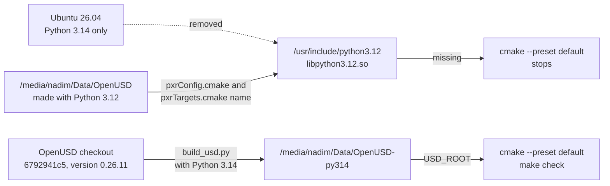

# The lessons build against an OpenUSD install made with Python 3.14 (issue #11)



## Problem

The operating system upgrade to Ubuntu 26.04 removed the Python 3.12
development files. The system Python is 3.14.4. `apt` has no
`python3.12-dev`.

The OpenUSD install at `/media/nadim/Data/OpenUSD` is version 0.26.11
(branch `dev`, commit `6792941c5`). It was made on 2026-08-22 with GCC 13.3
and Python 3.12.3. Its CMake package names Python 3.12 in two places:

- `pxrConfig.cmake` calls
  `find_dependency(Python3 "3.12" EXACT COMPONENTS Development)`. The
  configure step stops here.
- `pxrTargets.cmake` puts `/usr/include/python3.12` in the include
  directories of the imported targets.

A test on 2026-11-23 gave the configure step the Python 3.12 development
files from a different location. The find step passed. The generate step
stopped: `Imported target "usd" includes non-existent path
"/usr/include/python3.12"`. Thus a different Python 3.12 does not repair the
install. The install must be made again.

Effects:

- No lesson builds. `make check` and `make pr` fail.
- `usdview` from the install stops with a segmentation fault. Its
  interpreter is now Python 3.14, and its modules are made for Python 3.12.
- The interactive prompt and `make check-tree` operate. The runtime library
  `libpython3.12.so.1.0` is still on the machine.

OpenUSD supports Python 3.14 from release 26.05 (its `CHANGELOG.md`).

## Requirements

- **R1.** The command that configures the build completes with no error on
  the development machine.
- **R2.** Every lesson builds and runs, as a compiled program and at the
  interactive prompt.
- **R3.** The OpenUSD tools that the editor workflow starts (the viewer, the
  checker, the text dump) operate.
- **R4.** The interactive prompt stays in operation while the new install is
  made. The old install stays on the disk until the new install satisfies
  R1, R2 and R3.
- **R5.** The OpenUSD version does not change. Only the Python version
  changes.
- **R6.** The repository records how the OpenUSD install is made.

## Specification

- **S1 (R5).** The source is the checkout `/media/nadim/Data/Source/OpenUSD`
  at commit `6792941c5d5b42778e6875c5ed5a3279e6936981`. This is the commit
  of the old install.
- **S2 (R1, R3).** The Python is the system Python 3.14:
  `/usr/bin/python3.14`, `/usr/include/python3.14` and `libpython3.14.so`
  (package `python3.14-dev`). A virtual environment at `<prefix>/venv` holds
  PySide6, PyOpenGL and Jinja2:

  ```sh
  uv venv --python /usr/bin/python3.14 /media/nadim/Data/OpenUSD-py314/venv
  uv pip install --python /media/nadim/Data/OpenUSD-py314/venv/bin/python PySide6 PyOpenGL jinja2
  ```

  `build_usd.py` runs with the interpreter of this environment. Then
  `pxrConfig.cmake` and the scripts in `bin/` name this interpreter.
- **S3 (R4).** The prefix of the new install is
  `/media/nadim/Data/OpenUSD-py314`. The old install stays at
  `/media/nadim/Data/OpenUSD`.
- **S4 (R5).** The build command uses the default components of
  `build_usd.py`, as the old install did: imaging, usdview, MaterialX,
  OpenSubdiv, TBB, the tools, the examples and the tutorials.

  ```sh
  PREFIX=/media/nadim/Data/OpenUSD-py314
  PATH=$PREFIX/venv/bin:$PATH $PREFIX/venv/bin/python \
      /media/nadim/Data/Source/OpenUSD/build_scripts/build_usd.py -j 20 $PREFIX
  ```

- **S5 (R1).** `cmake/OpenUSDExample.cmake` puts
  `/media/nadim/Data/OpenUSD-py314` first in its list of candidate
  locations. The old location stays in the list after it. The root
  `README.md` names the new location in "Build".
- **S6 (R1, R2).** The build directory gets the new location:
  `cmake --preset default -DUSD_ROOT=/media/nadim/Data/OpenUSD-py314`. The
  cache of `build/` holds the old `USD_ROOT`, thus the `-D` is necessary one
  time. Then `make check` passes.
- **S7 (R3).** These commands complete with exit code 0, with
  `PYTHONPATH=$PREFIX/lib/python3.14/site-packages` and `$PREFIX/bin` in
  `PATH`: `usdview --help`, `usdchecker --help`, and `usdcat` on a file
  that a lesson wrote.
- **S8 (R6).** The root `README.md` gets a section "Building OpenUSD" with
  the commands of S2 and S4.
- **S9 (R4).** The human deletes the old install. An agent does not delete
  it.

## Verification

| Requirement | Check |
| --- | --- |
| R1 | `cmake --preset default` prints `OpenUSD 0.26.11 from /media/nadim/Data/OpenUSD-py314` and no error |
| R2 | `make check` passes: each lesson has a compiled test and a `repl_` test |
| R3 | The three commands of S7 |
| R4 | `repl/usd-repl` operates during the build; `/media/nadim/Data/OpenUSD` has no changed file |
| R5 | `PXR_VERSION` in `include/pxr/pxr.h` is 2611 in the two installs |
| R6 | The section "Building OpenUSD" is in `README.md` |

## State on 2026-11-23

- S1 to S4 are done. `build_usd.py` completed with exit code 0, with
  GCC 15.2 and CMake 4.2. The install is at
  `/media/nadim/Data/OpenUSD-py314` (2.4 GB). No file of the old install
  changed.
- S7 is checked: the three commands complete with exit code 0.
- A build directory outside the repository, configured with
  `-DUSD_ROOT=/media/nadim/Data/OpenUSD-py314`, builds all the lessons and
  passes all the tests, compiled and at the prompt.
- S5, S6 and S8 are not done. They change files of the repository, or the
  build directory of the human.

## Notes

- The lessons were compiled against Python 3.12 headers. The OpenUSD
  headers include `Python.h`, thus every lesson compiles again after S6.
- The Python modules of the new install are in
  `lib/python3.14/site-packages`. The old install has them in
  `lib/python3.12/site-packages`.

## Open decisions

- **D1.** S2 uses the Python of the operating system. The next upgrade of
  the operating system Python causes this failure again. A Python that the
  operating system does not replace (for example a CPython 3.14 that `uv`
  manages) prevents it. This plan uses the system Python, as issue #11
  proposes.
- **D2.** S5 changes the candidate list. The alternative is no change in
  the repository and `USD_ROOT` in the environment of the human.
